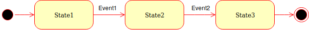
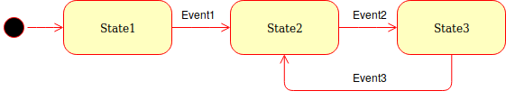
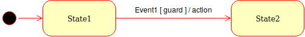

# smlang: A `no_std` State Machine Language DSL in Rust


> A state machine language DSL based on the syntax of [Boost-SML](https://boost-ext.github.io/sml/).

`smlang` is a procedural macro library creating a state machine language DSL, whose aim to facilitate the
use of state machines, as they quite fast can become overly complicated to write and get an
overview of.

The library supports both `async` and non-`async` code.

## Transition DSL

Below is a sample of the DSL. For a full description of the `statemachine` macro, please reference
the [DSL document](docs/dsl.md).

```rust
statemachine!{
    transitions: {
        *SrcState1 + Event1 [ guard1 ] / action1 = DstState2, // * denotes starting state
        SrcState2 + Event2 [ guard2 ] / action2 = DstState1,
    }
    // ...
}
```

Where `guard` and `action` are optional and can be left out. A `guard` is a function which returns
`Ok(true)` if the state transition should happen - otherwise, the transition should not happen.
The `action` functions are run during the state machine transition.

> This implies that any state machine must be written as a list of transitions.

The DSL supports wildcards and pattern matching for input states similar to rust pattern matching:

```rust
statemachine!{
    transitions: {
        *State1 | State3 + ToState2 = State2,
        State1 | State2 + ToState3 = State3,
        _ + ToState4 = State4,
        State4 + ToState1 = State1,
    }
    // ...
}
```

Which is equivalent to:

```rust
statemachine!{
    transitions: {
        *State1 + ToState2 = State2,
        State3 + ToState2 = State2,

        State1 + ToState3 = State3,
        State2 + ToState3 = State3,

        State1 + ToState4 = State4,
        State2 + ToState4 = State4,
        State3 + ToState4 = State4,
        State4 + ToState4 = State4,

        State4 + ToState1 = State1,
    }
    // ...
}
```
See example `examples/input_state_pattern_match.rs` for a usage example.

#### Internal transitions

The DSL supports internal transitions.
Internal transition allow to accept an event and process an action,
and then stay in the current state. 
Internal transitions can be specified explicitly, e.g.
```plantuml
State2 + Event2 / event2_action = State2,
```
or 
```plantuml
State2 + Event2 / event2_action = _,
```
or implicitly, by omitting the target state including '='.
```plantuml
State2 + Event2 / event2_action,
```
It is also possible to define wildcard implicit (or explicit using '_') internal transitions.  

```rust
statemachine! {
    transitions: {
        *State1 + Event2 = State2,
        State1 + Event3 = State3,
        State1 + Event4 = State4,
        
        _ + Event2 / event2_action,
    },
}
```
The example above demonstrates how you could make Event2 acceptable for any state,
not covered by any of the previous transitions, and to do an action to process it.

It is equivalent to:

```rust
statemachine! {
    transitions: {
        *State1 + Event2 = State2,
        State1 + Event3 = State3,
        State1 + Event4 = State4,
        
        State2 + Event2 / event2_action = State2,
        State3 + Event2 / event2_action = State3,
        State4 + Event2 / event2_action = State4,
    },
}
```

See also tests: `test_internal_transition_with_data()` or `test_wildcard_states_and_internal_transitions()` for a usage example.

#### Eventless transitions

A transition without `+ Event` is an eventless transition. It is taken without waiting for an
event, which makes it possible to write transient states and choice points. For example, a
state that checks the result of an action and then picks the next state:
```rust
statemachine! {
    transitions: {
        *Idle + StartEvent / configure = CheckConfiguration,
        CheckConfiguration [ configuration_successful ] = Ready,
        CheckConfiguration = Error,
    },
}
```
A single `process_event(Events::StartEvent)` call runs `configure` and ends in `Ready` or `Error`,
never in `CheckConfiguration`. Guards and actions are written as for any other transition,
for example `Flush / write_out = Idle`.

Eventless transitions are evaluated like this:

- After `process_event` takes a transition, including an internal transition, the eventless
  transitions of the resulting state are checked in the order they are declared. The first one
  whose guard passes, or which has no guard, fires.
- This is repeated until the current state has no enabled eventless transition. `process_event`
  returns that final state.
- They are not evaluated by `new()` or `new_with_state()`, nor at the start of `process_event`.
  Call `process_eventless()` to evaluate them on demand.

If no eventless transition is enabled, the machine stays in that state and `process_event`
returns `Ok`. This is not an error, unlike an event transition where no guard passes and
`TransitionsFailed` is returned. So a guarded eventless transition can act as a
conditional wait. With `S + Tick / work = _` and `S [done] = T`, every `Tick` runs `work`, and the
machine moves on to `T` as soon as `done` passes.

A machine with eventless transitions also gets a public method `process_eventless()`. It takes the
eventless transitions of the current state in the order they are declared, until the machine
reaches a state without an enabled eventless transition, and returns that state. If none is
enabled, nothing happens and the current state is returned. `process_event` calls it after
every transition into a state with eventless transitions. It is `async` if an eventless guard or
action is async, or if `entry_exit_async` is set. Use it to:

- retry after an eventless guard or action returned an error, see below,
- settle a machine created with `new_with_state` in a state that has eventless transitions,
- check the guards of a resting state again, for example to poll a condition without an event
  (`Waiting [ready] = Go`).

If a guard or action of an eventless transition returns an error, `process_event` returns
`GuardFailed` or `ActionFailed`. The transition of the event and earlier eventless steps are not
rolled back, so the machine stays in the source state of the failed eventless transition. Use
`sm.state()` to find out where it stopped.

Recovery works as for event transitions. If a guard returned an error, nothing of that transition
ran. If an action returned an error, `on_exit` of the source state has run, but the state is
unchanged. For an event transition, sending the event again retries it. This does not work for
an eventless transition: the machine has already left the source state of the event, so the
event no longer leads to the failed step, and usually returns `InvalidEvent`. Call
`process_eventless()` instead, as often as needed. As for an event transition, `on_exit` of the
source state runs again when a failed action is retried.
```rust
match sm.process_event(Events::StartEvent) {
    Err(Error::GuardFailed(_)) => {
        // The machine rests in `CheckConfiguration`, the source state of the failed
        // eventless transition. Fix the cause, then retry:
        sm.process_eventless()?;
    }
    // ...
}
```

The following is checked at compile time:

- An eventless transition needs an explicit target. Internal forms, `= _` or no target, are not
  allowed. Use `S [guard] / action = S` for an intentional loop.
- The source cannot be the wildcard `_`.
- The starting state cannot have eventless transitions.
- Loops of eventless transitions that can never end are rejected. A loop never ends when it is
  made of unguarded transitions and no guarded eventless transition leads out of it, for
  example `S / action = S` on its own, or `A [g] = B, A = B, B = A`.
- The usual rules for transitions from one state apply: at most one unguarded transition, no
  guarded transition after an unguarded one, consistent guard and action signatures, and a target
  with state data needs an action.

Loops that a guard can end are allowed, for example `S [done] = T` together with
`S / work = S`. Making sure they end is up to you.

Guards and actions of eventless transitions have the usual signatures, without the event data
parameter. If a `temporary_context` is configured, they receive it. It must be `Copy` or a
`&mut` reference, because `process_event` also passes the same value to the guard and action of
the event transition. `process_eventless()` takes the `temporary_context` only if at least one
eventless transition has a guard or action. So an owned context such as `String` works with
eventless transitions that have none. The `log_guard`, `log_action` and `transition_callback`
hooks are also called for eventless transitions, `log_process_event` is not.

See example `examples/eventless_transition.rs` for a usage example.

#### Guard expressions

Guard expression in square brackets [] allows to define a boolean expressions of multiple guard functions.
For example:
```rust
statemachine! {
  transitions: {
      *Init + Login(Entry) [valid_entry] / attempt = LoggedIn,
      Init + Login(Entry) [!valid_entry && !too_many_attempts] / attempt = Init,
      Init + Login(Entry) [!valid_entry && too_many_attempts] / attempt = LoginDenied,
      LoggedIn + Logout / reset = Init,
  }
}
```
Guard expressions may consist of guard function names, and their combinations with &&, || and ! operations.

#### Multiple guarded transitions for the same state and triggering event
Multiple guarded transitions for the same state and triggering event are supported (see the example above).
It is assumed that only one guard is enabled in such a case to avoid a conflict over which transition should be selected.
However, if there is a conflict and more than one guard is enabled, the first enabled transition,
in the order they appear in the state machine definition, will be selected.

### State machine context

The state machine needs a context to be defined.
The `StateMachineContext` is generated from the `statemachine!` proc-macro and is what implements
guards and actions, and data that is available in all states within the state machine and persists
between state transitions:

```rust
statemachine!{
    transitions: {
        State1 + Event1 = State2,
    }
    // ...
}

pub struct Context;

impl StateMachineContext for Context {}

fn main() {
    let mut sm = StateMachine::new(Context);

    // ...
}
```

See example `examples/context.rs` for a usage example.


### State data

Any state may have some data associated with it:

```rust
pub struct MyStateData(pub u32);

statemachine!{
    transitions: {
        State1(MyStateData) + Event1 = State2,
    }
    // ...
}
```

See example `examples/state_with_data.rs` for a usage example.

If the starting state contains data, this data must be provided after the context when creating a new machine.

```rust
pub struct MyStateData(pub u32);

statemachine!{
    transitions: {
        State2 + Event2 / action = State1(MyStateData),
        *State1(MyStateData) + Event1 = State2,
        // ...
    }
    // ...
}

// ...

let mut sm = StateMachine::new(Context, MyStateData(42));
```

State data may also have associated lifetimes which the `statemachine!` macro will pick up and add the `States` enum and `StateMachine` structure. This means the following will also work:

```rust
pub struct MyStateData<'a>(&'a u32);

statemachine! {
    transitions: {
        *State1 + Event1 / action = State2,
        State2(MyStateData<'a>) + Event2 = State1,
        // ...
    }
    // ...
}
```

See example `examples/state_with_reference_data.rs` for a usage example.

### Event data

Data may be passed along with an event into the `guard` and `action`:

```rust
pub struct MyEventData(pub u32);

statemachine!{
    transitions: {
        State1 + Event1(MyEventData) [guard] = State2,
    }
    // ...
}
```

Event data may also have associated lifetimes which the `statemachine!` macro will pick up and add the `Events` enum. This means the following will also work:

```rust
pub struct MyEventData<'a>(pub &'a u32);

statemachine!{
    transitions: {
        State1 + Event1(MyEventData<'a>) [guard1] = State2,
        State1 + Event2(&'a [u8]) [guard2] = State3,
    }
    // ...
}
```

See example `examples/event_with_data.rs` for a usage example.

### Guard and Action syntax

See example `examples/guard_action_syntax.rs` for a usage-example.

### Async Guard, Action And Entry/Exit

Guards and actions may both be optionally `async`:
```rust
use smlang::{async_trait, statemachine};

statemachine! {
    entry_exit_async: true,
    transitions: {
        *State1 + Event1 [guard1] / async action1 = State2,
        State2 + Event2 [async guard2] / action2 = State3,
    }
}


pub struct Context {
    // ...
}

impl StateMachineContext for Context {
    async fn action1(&mut self) -> () {
        // ...
    }

    async fn guard2(&mut self) -> Result<(), ()> {
        // ...
    }

    fn guard1(&mut self) -> Result<(), ()> {
        // ...
    }

    fn action2(&mut self) -> () {
        // ...
    }

    async fn on_entry_state1(&mut self) {
        // ...
    }

    async fn on_exit_state2(&mut self) {
        // ...
    }
}
```

See example `examples/async.rs` for a usage-example.

## State Machine Examples

Here are some examples of state machines converted from UML to the State Machine Language DSL.
Runnable versions of each example is available in the `examples` folder. The `.png`s are generated
with the `graphviz` feature.

### Linear state machine



DSL implementation:

```rust
statemachine!{
    transitions: {
        *State1 + Event1 = State2,
        State2 + Event2 = State3,
    }
}
```

This example is available in `ex1.rs`.

### Looping state machine



DSL implementation:

```rust
statemachine!{
    transitions: {
        *State1 + Event1 = State2,
        State2 + Event2 = State3,
        State3 + Event3 = State2,
    }
}
```

This example is available in `ex2.rs`.

### Using guards and actions



DSL implementation:

```rust
statemachine!{
    transitions: {
        *State1 + Event1 [guard] / action = State2,
    }
}
```

This example is available in `ex3.rs`.

### Using entry and exit functions in transitions

The statemachine will create for all states an `on_entry_` and `on_exit_` function.
If the are not used, they will be optimized away by the compiler. An example be
found in `on_entry_on_exit_generic`.

### Transition callback

The statemachine will call for every transition a transition callback. This function
is called with both the old state and new state as arguments. An example can be found
in `dominos`.

### Choice point with eventless transitions

`CheckConfiguration` has no event of its own. It is entered by `StartEvent` and then moves on to
`Ready` or `Error` depending on a guard.

DSL implementation:

```rust
statemachine!{
    transitions: {
        *Idle + StartEvent / configure = CheckConfiguration,
        CheckConfiguration [ configuration_successful ] = Ready,
        CheckConfiguration = Error,
    }
}
```

This example is available in `eventless_transition.rs`.

## Helpers

### Specify attributes for states and events

Setting `events_attr` and `states_attr` fields to a list of attributes to `Events` and `States` enums respectively. To derive Display, use `derive_more::Display`.


```rust
use core::Debug;
use derive_more::Display;
// ...
statemachine!{
    states_attr: #[derive(Debug, Display)],
    events_attr: #[derive(Debug, Display)],
    transitions: {
        *State1 + Event1 = State2,
    }
}

// ...

println!("Current state: {}", sm.state().unwrap());
println!("Expected state: {}", States::State1);
println!("Sending event: {}", Events::Event1);

// ...

```

### Hooks for logging events, guards, actions, and state transitions

The `StateMachineContext` trait defines (and provides default, no-op implementations for) functions that are called for each event, guard, action, and state transition. You can provide your
own implementations which plug into your preferred logging mechanism.

```rust
fn log_process_event(&self, current_state: &States, event: &Events) {}
fn log_guard(&self, guard: &'static str, result: &Result<(), ()>) {}
fn log_action(&self, action: &'static str) {}
fn log_state_change(&self, new_state: &States) {}
```

See `examples/state_machine_logger.rs` for an example which uses `states_attr` and `events_attr` to derive `Debug` implementations for easy logging.

## Contributors

List of contributors in alphabetical order:

* Emil Fresk ([@korken89](https://github.com/korken89))
* Mathias Koch ([@MathiasKoch](https://github.com/MathiasKoch))
* Ryan Summers ([@ryan-summers](https://github.com/ryan-summers))
* Donny Zimmanck ([@dzimmanck](https://github.com/dzimmanck))

---

## License

Licensed under either of

- Apache License, Version 2.0 [LICENSE-APACHE](LICENSE-APACHE) or <http://www.apache.org/licenses/LICENSE-2.0>
- MIT license [LICENSE-MIT](LICENSE-MIT) or <http://opensource.org/licenses/MIT>

at your option.

